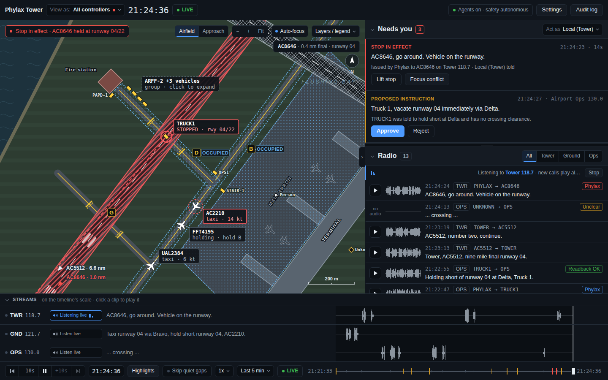
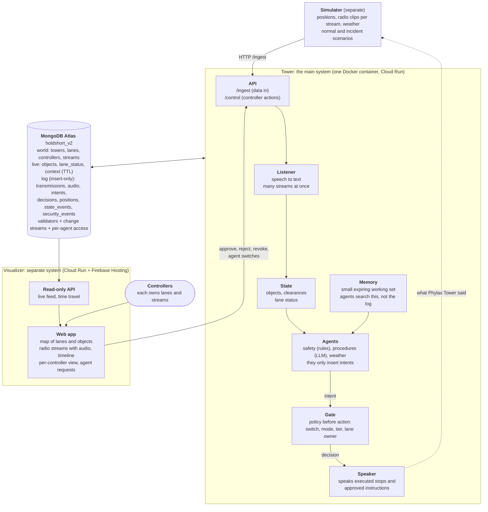

# Phylax Tower

AI agents that listen to airport tower radio, track every aircraft, vehicle and person on the
runways and taxiways, and stop a runway conflict before it happens. The controller stays in
charge: an agent can warn, stop or propose, it can never clear traffic, and every action is
checked before it runs and recorded in MongoDB Atlas so a reviewer can reconstruct it
afterwards. The demo replays the 22 March 2026 runway 4 collision at LaGuardia, rebuilt from
the NTSB preliminary report: a fire truck is cleared to cross the runway 20 seconds before a
landing jet reaches it, and the tower has about 13 seconds to get a stop call to the truck.

- **Live demo:** https://phylax-tower.web.app
- **Demo video:** the 60-second submission video is rendered from [`video/`](video/) (a Remotion project).



*The controller's screen during a runway incursion (scripted demo data). The safety agent's stop
is in effect and was spoken on the tower frequency, a proposed instruction waits for the
controller who owns the runway, and the radio streams share one time axis with the timeline.*

## Architecture

Three separate systems around one MongoDB Atlas database. Agents never act: they insert an
*intent*. The gate turns each intent into a *decision* (executed, pending approval, or
refused), and only the speaker can put an executed decision on a frequency.



A critical stop is autonomous by default: it runs and is spoken at once, and the controller who
owns the runway is told and can lift it. Everything else an agent wants (a proposed
instruction, a lane closure) waits for that controller. More in
[`docs/v2/ARCHITECTURE.md`](docs/v2/ARCHITECTURE.md).

## How it answers the hackathon statement

Built for the MongoDB "Agents in Context" hackathon (Toronto, 14 November 2026), statement 1,
"Agents You Can Audit": use Atlas as the identity, policy and audit layer for an agent that
takes real actions.

| The statement asks | Phylax Tower's answer |
|---|---|
| How do you decide what an agent may do, and enforce it before the action? | An agent can only insert an intent into its own `intents_<agent>` collection. Atlas `$jsonSchema` validators (agent identity, no "clear" action), a per-agent database handle limited to the read and write lists in its `permissions` document, and the gate (switch, mode, tier, lane owner) all run before any decision executes. Optionally each agent connects as its own short-lived Atlas database user generated from that document. |
| How do you record what it did, why, and under whose authority? | Insert-only `decisions` carry the rule, `authorized_by` (permission document and rule set version), the controller it was routed to and who approved it. Every blocked attempt (wrong controller, denied read, validator rejection) lands in `security_events`; every switch, lane and rule set change in `state_events`. The visualizer's time travel and the audit agent rebuild any past moment from these records alone. |
| How do you stop or roll back an agent mid-run? | Per-agent and master switches, mode (`reactive` = warn only) and tier (`autonomous`, `needs_approval`, `never`) take effect on the agent's next intent. Revoking a decision inserts a new decision that points at the old one, so the log is never edited. |

## Repository map

| Path | What it is |
|---|---|
| [`holdshort/`](holdshort/) | The tower, the product itself (the Python package kept its build-time name): API, listener, state, memory, agents, gate, speaker, audit agent |
| [`visualizer/`](visualizer/) | A separate read-only viewer: `api/` serves the stored records, `web/` is the controller's screen |
| [`simulator/`](simulator/) | A separate program that feeds the tower over HTTP: traffic, radio and weather scenarios, including the LaGuardia reconstruction |
| [`scripts/`](scripts/) | Database setup, start and stop scripts, end-to-end checks |
| [`tools/`](tools/) | A small stand-in feed used by the tests and `scripts/feed.sh` |
| [`tests/`](tests/) | The tower's tests (they need an Atlas connection string) |
| [`deploy/`](deploy/) | Dockerfiles, Compose file, Cloud Run and Firebase Hosting scripts |
| [`video/`](video/) | The demo video project |
| [`docs/`](docs/) | Design documents: architecture, plan, data contracts, the ingest API |
| [`TESTING.md`](TESTING.md) | A click-through of the running system and the automated checks |

## Quick start

You need Python 3.11 or newer with [uv](https://docs.astral.sh/uv/), Node 20 or newer, `ffmpeg`
and a MongoDB Atlas cluster.

```bash
cp .env.example .env                        # set MONGODB_URI; everything else is optional
ln -s "$PWD/.env" visualizer/api/.env       # the visualizer API reads its own .env
uv sync
scripts/run_all.sh                          # tower :8000, visualizer API :8100, web app :5180
```

Open http://localhost:5180, then play a scenario from a second terminal:

```bash
cd simulator && uv sync
uv run python -m hssim run laguardia --api http://localhost:8000   # the LaGuardia replay
uv run python -m hssim run crossing  --api http://localhost:8000   # a shorter runway crossing conflict
```

`scripts/stop_all.sh` stops everything. Without the optional keys the tower degrades instead
of failing: rule and template text instead of the language model, the feed's own text and
placeholder tones instead of speech.

To see the screen with no backend at all, run `npm ci && npm run dev -- --port 5180` in
`visualizer/web` and open http://localhost:5180/?mock=1 (a scripted incident in the browser).

## Technology

| Technology | Used for |
|---|---|
| MongoDB Atlas | The identity, policy and audit layer. Schema validation refuses a malformed or forbidden write in the database itself; change streams drive every worker and the live screen; TTL collections hold the live picture and the agents' working memory; a time-series collection keeps every position for time travel; Atlas Search resolves misheard callsigns and Vector Search (automated Voyage embeddings) finds similar past incidents and searches working memory; GridFS stores the audio. |
| LangGraph with MongoDB checkpoints | The procedures agent's graph (gather, draft, check, emit). A killed agent resumes where it stopped and never proposes twice. |
| Gemini 4 Argon on Vertex AI | Drafting the procedures agent's proposals and the audit agent's narrative, and labelling radio calls the rules cannot parse. |
| ElevenLabs | Speech-to-text and voice isolation on incoming radio clips; the spoken stop calls and approved instructions. |
| FastAPI, React and Vite | The tower and visualizer APIs; the web app. |
| Cloud Run and Firebase Hosting | Hosting: the two APIs on Cloud Run (always-on workers, WebSockets), the web app on Firebase Hosting. |

## Team

| Name | GitHub |
|------|--------|
| Mani Fatemi | [@Ma1305](https://github.com/Ma1305) |
| Ariyan Azami | [@AriyanAzami](https://github.com/AriyanAzami) |
| Sahand Samadirad | [@sahandsamadirad](https://github.com/sahandsamadirad) |
| Amirali Akef | [@AmiraliAkef](https://github.com/AmiraliAkef) |

## Limits

- Controllers have no login: the web app sends the chosen `controller_id` with each action.
  The routing and the 403 for a controller who does not own the lane are real; the identity
  behind it is not verified.
- Transcript parsing is rule-based for standard phraseology, so the safety path never waits on
  a language model. The model is asked only when the rules cannot fully parse a call, and its
  output is normalised and checked in code.
- Speech-to-text runs under a deadline (`ELEVENLABS_TIMEOUT_S`; 2.5 s in the demo). When it
  expires or fails, the listener falls back to the text the feed sent with the clip, and with
  no text at all the call is stored as "unclear, say again".
- The airport is a hand-made schematic of LaGuardia, not a survey, and positions come from
  the simulator, not from real surveillance.
- One tower and one set of workers: the hosted tower is pinned to a single instance, because
  two would each process every event.
- All radio audio is synthetic. No real ATC recordings are in the repository.
