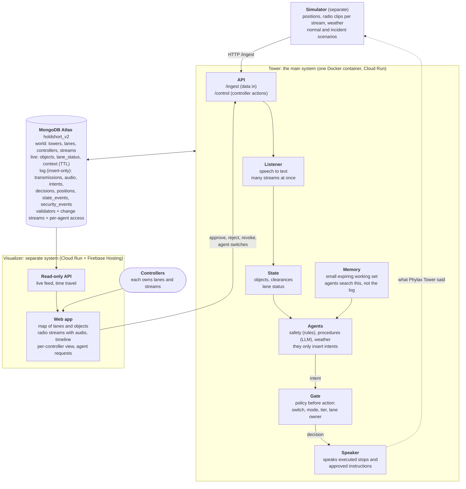
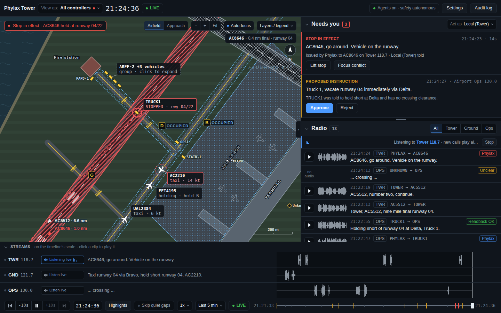

# Phylax Tower: architecture

Three separate systems around one MongoDB Atlas database. Details: [`PLAN.md`](PLAN.md)
(design), [`CONTRACTS.md`](CONTRACTS.md) (data and APIs),
[`SIMULATOR_CONTRACT.md`](SIMULATOR_CONTRACT.md) (how data enters).

How a conflict flows:

1. The simulator posts positions once a second and each radio call as an audio clip on its stream.
2. The listener turns clips into transcripts (ElevenLabs speech-to-text, then a rule-based
   parser; a language model is asked only when the rules cannot parse a call). The state
   service works out who is cleared onto, and who is physically on, each lane.
3. The safety agent, which is deterministic rules and no language model, sees a conflict and
   inserts an intent. It cannot act.
4. The gate checks the agent's switch, mode and tier and writes a decision, routed to the
   controller who owns the lane. A critical stop is autonomous by default: it runs at once and
   that controller is told and can lift it. Anything else waits for that controller.
5. The speaker says the executed call on the right frequency. The simulator's traffic obeys.
6. The procedures agent (a LangGraph graph on Gemini, Vertex AI) proposes what the controller
   could say next. A proposal is never spoken until the owning controller approves it.
7. Every step is a document in Atlas, so the visualizer can replay any past moment and the
   audit agent can answer "why was this aircraft held?" from the stored records alone.

## The controller's screen

- **Needs you**: a stop in effect (with **Lift stop**), proposals waiting for approval, recent
  advisories. Nothing else asks for attention.
- **Radio** and the **streams dock**: every call with its audio; one row per stream on the
  timeline's own time axis, with **Listen live**.
- **Timeline**: drag it to see any past moment rebuilt from the records. **Highlights** steps
  through the major events ([screenshot](screens/history-highlights.png)).
- **Settings**: the master switch and each agent's switch, mode, tier and Atlas identity
  ([screenshot](screens/settings.png)).
- **Audit log**: every gate decision with its rule, authority and approver, and a box to ask
  the audit agent ([screenshot](screens/audit-log.png)).
