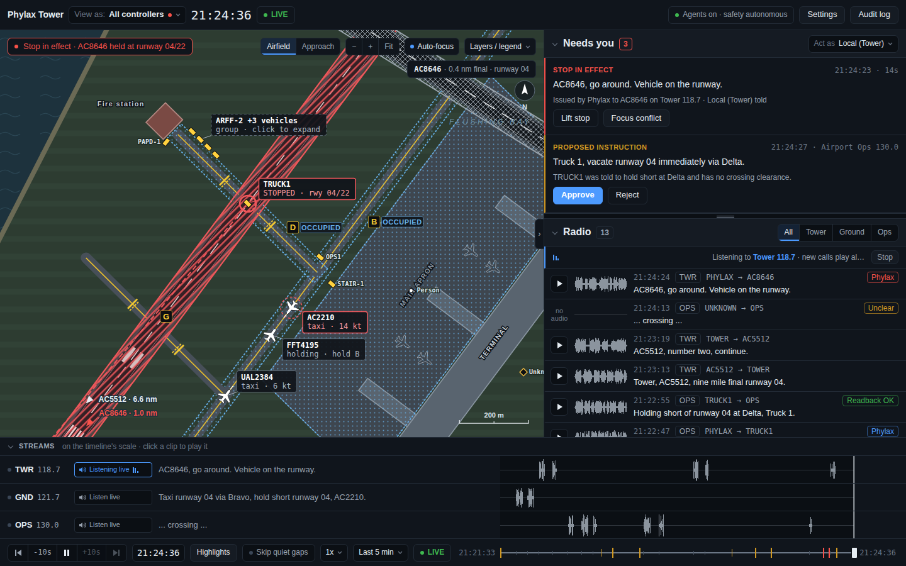

# Phylax Tower visualizer: web app

The screen a controller looks at. It reads everything from the visualizer API (`/viz/*`, see
[`docs/v2/CONTRACTS.md`](../../docs/v2/CONTRACTS.md)) and sends controller actions to the
tower's `/control/*` API. It never talks to the database.



- **Top bar**: "View as" (all controllers, or one controller's lanes, streams and requests), the
  clock, LIVE or HISTORY, the state of the agents in a few words, **Settings** and **Audit log**.
- **Map**: drawn from the world data (SVG, no map tiles, no keys). Lanes by state (colour,
  pattern and a text tag), objects by kind, Airfield and Approach views, zoom, and auto-focus on
  a conflict when it begins.
- **Needs you**: the only things that need a person. A stop in effect (the exact call, who was
  told, **Lift stop**), proposals waiting for the owning controller (**Approve** / **Reject**)
  and recent advisories. "Act as" picks the controller the action is sent as; a refused action
  shows the tower's answer inline (for example `403 · not_lane_owner`).
- **Radio**: every call as one list with its audio, a waveform, who spoke to whom and tags
  (clearance, readback OK, unclear, Phylax's own calls).
- **Streams dock**: one row per radio stream on the timeline's own time axis. **Listen live**
  plays a stream's new calls as they arrive; click a clip to play it.
- **Bottom bar**: the timeline. Drag it to see the airfield as it was (history mode: amber
  frame, actions disabled). **Highlights** steps through the major events of the window,
  **Skip quiet gaps** jumps over silence during playback, and LIVE returns to now.
- **Settings**: the master switch, and for each agent its switch, mode (reactive or proactive),
  tier (autonomous, needs approval, never) and the Atlas identity it connected with.
- **Audit log**: every gate decision, newest first, with its rule, `authorized_by` and who
  approved it; and **Ask the audit agent** (the tower's `GET /control/audit?q=`).

Keys: space plays or pauses, the arrow keys step 5 s (with shift: to the next event), `L` goes
live, `]` hides the side panel.

## Run

```bash
npm ci
npm run dev -- --port 5180        # http://localhost:5180
```

Without a backend, open **http://localhost:5180/?mock=1**: a scripted runway incursion generated
in the browser from `src/mock/world_lga.json` (a copy of `docs/v2/world_lga.json`), with a few
minutes of history. Mock audio is a placeholder tone per clip.

## Configuration

Copy `.env.example` to `.env` (gitignored). Values are read at build time.

| Variable | Default | Used for |
|---|---|---|
| `VITE_VIZ_API` | `http://localhost:8100` | `/viz/*`, `/viz/audio/{clip_id}` and the `/viz/live` WebSocket (connected directly) |
| `VITE_TOWER_API` | `http://localhost:8000` | `POST /control/approve`, `/control/reject`, `/control/revoke`, `/control/permissions/{agent}`, `GET /control/audit` |

## Build and deploy

```bash
npm run build        # type-check (tsc) + vite build -> dist/
```

`firebase.json` serves `dist/` with an SPA fallback. Firebase rewrites do not carry WebSockets,
so the app connects straight to the API URLs baked in at build time, and the tower's
`CORS_ORIGINS` must include the hosting origin. [`deploy/firebase.sh`](../../deploy/firebase.sh)
does the build and the deploy.

## Code

```
src/types.ts            contract shapes and the DataSource interface
src/source.ts           HTTP and WebSocket source (VITE_VIZ_API, VITE_TOWER_API); picks mock on ?mock=1
src/mock/               the mock source: scenario, placeholder audio
src/App.tsx             live and history state, playback, highlights, audio queue, controller filter
src/components/         MapView, NeedsYou, Radio, StreamDock, Timeline, AgentPills (settings), Requests (audit log), Menu
scripts/                Playwright checks (see below)
```

## Playwright checks

`npm run pair` (`scripts/run_pair.sh`, `scripts/pair.mjs`) drives the built app against a
visualizer API seeded with `../api/seed_demo.py`, and `scripts/integration.mjs` drives it against
the real tower (`scripts/viz_integration.sh` at the repo root). Both were written before the
final redesign of the screen: their selectors target the earlier layout and have not been
updated or re-run against this one.
